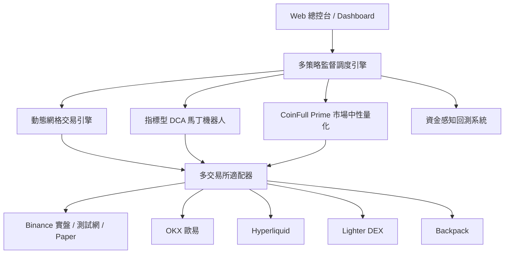

# Grid Trading Console

一個專為加密貨幣量化交易設計的高可靠、多交易所交易引擎與 Web 視覺化總控台。

本專案集成了**動態網格交易**、**指標型 DCA 馬丁機器人**、**CoinFull Prime 市場中性多空截面策略**以及**資金感知全功能回測系統**，提供從策略研發、歷史回測、實盤對帳自癒到實時持倉監控的一站式解決方案。

---

## 核心策略模組



### 1. 動態網格交易引擎 (Dynamic Grid Trading)
* **多模式支援**：中性網格（區間震盪收割）、做多網格（趨勢跟隨低吸）、做空網格（高拋低補）。
* **自適應間距與動態重置**：支援等比、等差間距配置，當價格突破區間時可自動觸發動態重置或嚴格停損。
* **收益即時核算**：前後端貫徹純淨收益會計恆等式：$\text{Net PnL} = \text{Grid Profit} + \text{Unrealized PnL} - \text{Total Fees}$。

### 2. 指標型 DCA 馬丁機器人 (Indicator-Driven Martingale DCA)
* **冷卻監聽模式 (`armed`)**：入場信號成立前，交易所端維持零掛單，節省保證金與 API 權重。
* **多因子技術指標入場**：支援 **RSI**、**MACD**、**布林通道 (Bollinger Bands)**、**價格變動率 (Price Change)** 四種技術指標及其自由組合。
* **動態冷卻與循環重啟**：支援自訂冷卻時間（Cooldown）與止盈後自動循環重啟（Auto-Repeat），並可在運行中熱更新配置。
* **即時視覺化工作台**：內建 Lightweight Charts K 線圖表，實時繪製基礎單、安全單階梯、持倉均價線與動態止盈線。
* **三向對帳與自癒機制**：`ExchangeReconciler` 定期自動比對「本地帳本 $\leftrightarrow$ 交易所持倉 $\leftrightarrow$ 在世掛單」，遇到孤立部位時自動補掛止盈單，單向機器人嚴格過濾反向持倉避免誤領。

### 3. CoinFull Prime 市場中性截面多空策略 (CoinFull Prime Market-Neutral Quant)
* **全市場流動性截面**：每日自幣安永續合約提取 24h 成交額前 79 個幣種作為流動性池（排除穩定幣）。
* **四大客觀微觀因子打分**：
  $$\text{Score} = 0.35 \cdot Z_{\text{動能}} + 0.35 \cdot Z_{\text{主動買賣流}} + 0.20 \cdot Z_{\text{資金費率(反向)}} + 0.10 \cdot Z_{\text{大戶多空比}}$$
  採用統計學 Winsorization 去極值與橫截面 Z-Score 標準化，選出 **Top 8 做多** 與 **Bottom 8 做空** 建立對稱組合。
* **三層抗干擾與防碰撞護欄**：
  1. **專屬籃子記帳隔離**（`coinfull_prime_active_basket.json`）：僅平倉本策略歷史選拔的退榜幣種，絕對不誤殺用戶手動倉位或外部合約。
  2. **外部運行中機器人避碰排除**：動態掃描 SQLite 與設定檔中運行中的網格/DCA 機器人標的，自選幣池全面剔除，防止保證金擠兌與衝突。
  3. **定時排程雙向同動**：零輪詢休眠排程（每日 UTC 00:00 / 台北 08:00 自動喚醒換倉），支援實盤與測試網環境熱切換。

### 4. 策略回測與壓力測試系統 (Strategy Backtesting & Stress Testing)
* **網格資金感知回測**：逐倉保證金/清算價格模擬，輸出總報酬率、買入持有對照 (Alpha)、最大回撤、已完成循環數與權益曲線。
* **極端情境壓力測試**：支援 $\pm 15\% / 30\% / 50\%$ 單向極端行情壓力測試，精確試算防爆倉所需追加保證金。
* **DCA 實盤同源回測**：直接複用實盤 `DcaCoordinator` 與 `DcaOrderExecutor` 進行歷史 Tick / K 線回放，杜絕「回測一套、實盤一套」的擬合偏差。
* **多空截面實時行情觀測**：獨立全屏觀測分頁，實時查看 79 幣截面多空強度與指標評級。

---

## 支援交易所環境

| 交易所 | 支援業務 | 支援帳號環境 | 特色說明 |
| :--- | :--- | :--- | :--- |
| **Binance (幣安)** | USDT-M / USDC-M 永續合約、現貨 | Live 實盤 / Testnet 測試網 / Paper 模擬盤 | 深度最佳、完整支援 REST + WebSocket 雙向回報 |
| **OKX (歐易)** | 永續合約 (SWAP)、現貨 | Live 實盤 / 模擬盤 | 支援多幣種保證金帳戶與高頻 API |
| **Hyperliquid** | L1 去中心化永續合約 | Mainnet / Testnet | 免 Gas 費的高速鏈上撮合 |
| **Lighter DEX** | 去中心化訂單簿合約 | Arbitrum Mainnet | 零滑價極速下單體驗 |
| **Backpack** | 永續合約、現貨 | Live 實盤 | 新一代高效能訂單簿交易所 |

---

## 帳戶模式與安全機制

| 模式 | 行為與資金屬性 |
| :--- | :--- |
| **`PAPER` (本地模擬盤)** | 讀取交易所即時公開行情，於本機記憶體訂單簿撮合成交。每個模擬策略享有獨立帳戶與初始虛擬資金，零資金風險。 |
| **`TESTNET` (交易所測試網)** | 對接幣安等交易所官方測試網沙盒環境，發送真實撮合請求，使用水龍頭免費測試金驗證策略完整鏈路。 |
| **`LIVE` (真實實盤)** | 向真實交易所下單。系統嚴格受 `GRID_LIVE_TRADING_ENABLED=true` 雙重開關保護，未開啟前全面阻斷任何實盤訂單。 |

---

## 快速上手指引

### 1. 系統需求
* **Python**：3.11 或更新版本
* **Node.js**：22.0.0 或更新版本
* **Redis**（可選）：用於多進程事件發布/訂閱與快取

### 2. 下載與安裝
```bash
# 複製專案
git clone https://github.com/Domino101/grid-trading-console.git
cd grid-trading-console

# 建立並啟用 Python 虛擬環境
python3 -m venv venv
source venv/bin/activate

# 安裝後端依賴
pip install -r requirements.txt

# 安裝前端依賴
cd web_ui/frontend
npm ci
cd ../..
```

### 3. 環境變數配置
在專案根目錄建立 `.env` 檔案（或匯出環境變數）：

```bash
# Web UI / API 訪問 Token（必填，請妥善保管）
GRID_API_TOKEN=your_secure_random_api_token_here

# 實盤開關：預設關閉 (false)。欲開啟真實交易請設為 true
GRID_LIVE_TRADING_ENABLED=false

# 交易所 API 金鑰（依所需交易所配置）
BINANCE_API_KEY=your_binance_api_key
BINANCE_API_SECRET=your_binance_api_secret

# 測試網 API 金鑰（可選）
BINANCE_TESTNET_API_KEY=your_testnet_key
BINANCE_TESTNET_API_SECRET=your_testnet_secret

# 模擬盤起始參數（可選）
PAPER_STARTING_EQUITY=10000
PAPER_FEE_RATE=0.0002
```

### 4. 啟動本機開發服務

啟動調度引擎與 Web 控制台：

```bash
# 1. 啟動交易調度引擎（熱插拔待命模式）
python run_multiple_grids.py

# 2. 啟動後端 FastAPI 服務（監聽 8001 端口）
cd web_ui/backend
python main.py

# 3. 啟動前端開發伺服器（另開終端）
cd web_ui/frontend
npm run dev
```

開啟瀏覽器進入 `http://localhost:5173`，輸入設定的 `GRID_API_TOKEN` 即可登入使用。

---

## 正式生產部署

生產環境建議使用 **PM2** 或 **Systemd** 管理長時間運行的服務：

### 使用 PM2 管理
專案提供已設定好的 `ecosystem.config.js`：

```bash
# 編譯前端靜態資產
cd web_ui/frontend && npm run build && cd ../..

# 使用 PM2 啟動所有服務
pm2 start ecosystem.config.js

# 查看狀態
pm2 list
pm2 logs
```

### 使用 Systemd 服務
服務單元設定檔位於 `scripts/deployment/crypto-webui.service`，可複製至 `/etc/systemd/system/` 啟用：

```bash
sudo cp scripts/deployment/crypto-webui.service /etc/systemd/system/
sudo systemctl daemon-reload
sudo systemctl enable --now crypto-webui
```

---

## 專案目錄結構

```text
grid-trading-console/
├── core/                               # 核心業務與量化引擎
│   ├── adapters/                       # 多交易所適配層 (Binance, OKX, Hyperliquid, Lighter, Backpack, Paper)
│   ├── infrastructure/                 # 基礎設施 (Canonical Ledger, SQLite, Redis Support)
│   ├── services/
│   │   ├── grid/                       # 網格策略實現、協調器、風控與回測模擬器
│   │   ├── dca/                        # DCA 馬丁策略、指標計算、梯單管理與回測引擎
│   │   ├── coinfull_prime/             # CoinFull Prime 截面打分、持倉 Diffing 平衡器與定時調度
│   │   └── reconciler/                 # 實時對帳引擎 (ExchangeReconciler)
│   └── system/                         # 系統日誌、進程監控與錯誤捕獲
├── web_ui/                             # 總控台前後端
│   ├── backend/                        # FastAPI 服務、RESTful 路由、WebSocket 事件推送
│   └── frontend/                       # React 19 + TypeScript + Vite 前端 SPA 介面
├── config/                             # 策略設定檔目錄 (grid/, dca/, coinfull_prime/)
├── data/                               # 本機 SQLite 數據庫、排程狀態與持倉籃子快照 (已忽略版本控制)
├── docs/                               # 策略詳細設計手冊、架構規範與 API 說明文件
├── scripts/                            # 運維、部署、CI 檢查與維護腳本
└── tests/                              # 單元測試與整合驗證套件
```

---

## 測試與驗證

本專案遵循嚴格的自動化測試標準，包含單元測試、HTTP 接口合約驗證與前端端到端驗證：

```bash
# 執行全套 CI 整合驗證
./scripts/ci.sh

# 或分開執行：
# 1. 執行 Python 單元與架構測試
python3 -m unittest discover -s tests

# 2. 執行前端單元測試與 Production Build
cd web_ui/frontend
npm test -- --run
npm run build
```

---

## 風險與免責聲明

1. **投資風險**：加密貨幣與衍生品合約交易具備高波動性與高槓桿風險，可能導致本金部分或全部損失。
2. **非投資建議**：本專案所有程式碼、量化模型、策略回測與市場指標僅供技術研究與程式開發參考，不構成任何形式之投資建議。
3. **安全審計**：上線實盤前，請務必先在 `PAPER` 模擬盤或 `TESTNET` 測試網進行充分壓力測試，並謹慎保管您的 API 金鑰。
