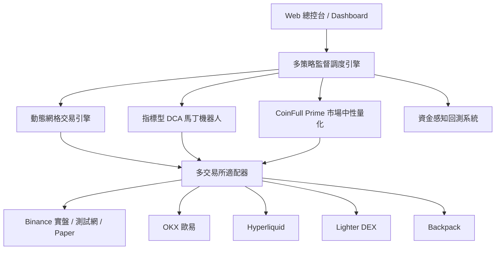

# Grid Trading Console

一個專為加密貨幣量化交易設計的高可靠、多交易所交易引擎與 Web 視覺化總控台。

本專案集成了**動態網格交易**、**指標型 DCA 馬丁機器人**、**CoinFull Prime 市場中性多空截面策略**以及**資金感知全功能回測系統**，提供從策略研發、歷史回測、實盤對帳自癒到實時持倉監控的一站式解決方案。

---

## 核心策略模組



### 1. 動態網格交易引擎 (Dynamic Grid Trading)
* **多模式支援**：中性網格（區間震盪收割）、做多網格（趨勢跟隨低吸）、做空網格（高拋低補）。
* **自適應間距與動態重置**：支援等比、等差間距配置，當價格突破區間時可自動觸發動態重置或嚴格停損。
* **收益即時核算**：前後端貫徹純淨收益會計恆等式：$\text{Net PnL} = \text{Grid Profit} + \text{Unrealized PnL} - \text{Total Fees}$。

### 2. 指標型 DCA 馬丁機器人 (Indicator-Driven Martingale DCA)
* **冷卻監聽模式 (`armed`)**：入場信號成立前，交易所端維持零掛單，節省保證金與 API 權重。
* **多因子技術指標入場**：支援 **RSI**、**MACD**、**布林通道 (Bollinger Bands)**、**價格變動率 (Price Change)** 四種技術指標及其自由組合。
* **動態冷卻與循環重啟**：支援自訂冷卻時間（Cooldown）與止盈後自動循環重啟（Auto-Repeat），並可在運行中熱更新配置。
* **即時視覺化工作台**：內建 Lightweight Charts K 線圖表，實時繪製基礎單、安全單階梯、持倉均價線與動態止盈線。
* **三向對帳與自癒機制**：`ExchangeReconciler` 定期自動比對「本地帳本 $\leftrightarrow$ 交易所持倉 $\leftrightarrow$ 在世掛單」，遇到孤立部位時自動補掛止盈單，單向機器人嚴格過濾反向持倉避免誤領。

### 3. CoinFull Prime 市場中性多空策略 (CoinFull Prime Market-Neutral Quant, v3.0 Opt C / Opt D)
* **全市場流動性截面與嚴格過濾**：每週自幣安永續合約提取 24h 成交額 $\ge 50\text{M}$ USDT 之主流幣種（80 標的 Universe，排除穩定幣），並支援一鍵排除美股/ETF/商品等 TradFi 合約，維持純加密貨幣市場中性對沖。
* **多時距雙因子選拔 (Top 5 多頭)**：
  $$\text{Score} = 0.60 \cdot Z_{\text{動能(0.5\cdot R_{7d}+0.3\cdot R_{14d}+0.2\cdot R_{30d})}} + 0.40 \cdot Z_{\text{資金費率(3 日 9 次結算平滑, 反向)}}$$
  落實 7 日 ATR% $\le 20\%$ 與年化資金費率 $< 60\%$（單次 $< 0.0548\%$）之高負利差標的過濾，選出 **Top 5 做多標的**（各佔 10% 名義資金，多方合計 50%）。
* **基準指數對沖做空 (BTC 50% 權重對沖腿)**：
  - 空頭改採單主流 `BTCUSDT`（佔 50% 名義資金）對沖全市場系統性 Beta，徹底規避舊版對稱做空小幣時遭遇的「小幣暴拉反抽軋空」風險（雙基準模式支援 BTC 35% + ETH 15%）。
* **雙軌 -12% 硬止損保護機制 (Dual-Track Stop Loss Guard)**：
  - **交易所端預掛條件單（第一道防線）**：調倉多頭買入成交後，立即向交易所伺服端預掛帶有精確量化 `stopPrice` 的 `STOP_MARKET` (`closePosition=True`) 條件單。無須依賴本地輪詢，遇極端插針或網路波動亦能由交易所即時觸發市價平倉。
  - **本地守護與自癒結算（第二道防線）**：守護迴圈定期巡檢報價；若預掛單滑價或異常未觸發，以市價平倉補位。當交易所預掛單觸發成交後，`ExchangeReconciler` 與動態止損自動感知持倉變化與成交記錄，無縫執行 `apply_basket_fill(..., reduce_only=True)` 結算損益並入 Canonical Ledger，杜絕幽靈持倉與 `-2022` 拒單。
* **風險閘門 (Regime Gate)**：換倉前以 3 因子判定市場狀態：`pts = [BTC>50 日均線] + [廣度>30%] + [資金費率 252 日百分位>45]`：
  * `pts = 0`（風險關閉）→ **平倉並停止下單**（T1，實測 OOS Sharpe 0.84 → 1.94 的最大單一改善項）；
  * `pts = 2` 且資金費率百分位 45–80 → 可加碼至 1.15×（上限 1.2×）；
  * BTC 收盤日 ≤ −5%（崩跌日）→ 換倉延後 24 小時（T2，最多 2 次）；
  * 極端擁擠（百分位 >95 且 pts≤1）→ 降至 0.5×（T5）；
  * 決策逐次落地 `data/coinfull_prime_regime_history.jsonl`，查詢端點 `GET /api/v1/coinfull-prime/regime`。
* **三層抗干擾與防碰撞護欄**：
  1. **專屬籃子記帳隔離**（`StrategyLedger` + `bot_baskets`）：僅平倉本策略歷史選拔的退榜幣種，絕對不誤殺用戶手動倉位或外部合約。
  2. **外部運行中機器人避碰排除**：動態掃描 SQLite 與設定檔中運行中的網格/DCA 機器人標的，自選幣池全面剔除，防止保證金擠兌與衝突。
  3. **定時排程雙向同動**：零輪詢休眠排程（**每週四 UTC 00:05 / 台北 08:05** 自動喚醒換倉，頻率可於 `strategy_config.yaml` 調整），支援實盤與測試網環境熱切換。
* **績效可追蹤與深度報告**：每次換倉落地權益/持倉快照與完整訂單事件，詳見：
  - `docs/CoinFull_Prime_v3_Engineering_Spec_and_Optimization_Master.md`
  - `docs/CoinFull_Prime_v3_Comparative_Backtest_Report.md`
  - `docs/CoinFull_Prime_Strategy_Audit_and_Optimization_Report.md`
  - `docs/CoinFull_Prime_75d_Backtest_and_Strategy_Spec.md`

### 4. 策略回測與壓力測試系統 (Strategy Backtesting & Stress Testing)
* **網格資金感知回測**：逐倉保證金/清算價格模擬，輸出總報酬率、買入持有對照 (Alpha)、最大回撤、已完成循環數與權益曲線。
* **極端情境壓力測試**：支援 $\pm 15\% / 30\% / 50\%$ 單向極端行情壓力測試，精確試算防爆倉所需追加保證金。
* **DCA 實盤同源回測**：直接複用實盤 `DcaCoordinator` 與 `DcaOrderExecutor` 進行歷史 Tick / K 線回放，杜絕「回測一套、實盤一套」的擬合偏差。
* **多空截面實時行情觀測**：獨立全屏觀測分頁，實時查看 80 幣截面多空強度與指標評級。

---

## 高可靠工程守門與雙軌稽核規範

本專案將資金安全與記帳一致性置於最高優先級，在 `AGENTS.md` 與 `.agents/` 建立了嚴格的工程守門機制與自動化稽核體系：

### 1. 錯誤類別結構守門 (Mistake Classes MC-1 ~ MC-7)
所有重複性缺陷皆提升至架構層與 CI 自動化測試層強制消滅：
* **MC-1 反向翻倉越界防護**：`PortfolioRebalancer` 自動拆單為 Phase 1 `flip_close`（平舊倉，帶 `reduce_only` 釋放保證金）與 Phase 2 `flip_open`（開新反向倉），杜絕幣安 `-2022` 拒單。
* **MC-2 小幣槓桿自動預設**：下單前主動調用 `set_leverage(symbol, target_leverage=1)` 預設安全槓桿，杜絕低市值標的 `-2027` 拒單。
* **MC-3 換倉管線互斥鎖**：`CoinFullPrimeService` 採用 `asyncio.Lock()`，並發請求即時回傳 `409 Conflict` 阻斷，防止保證金穿倉。
* **MC-4 Dry-Run 模擬嚴格隔離**：模擬運行短路所有帳本寫入操作，嚴格遵循「Dry-Run 絕不改變帳本狀態」鐵則。
* **MC-5 避碰護欄精確作用域**：僅掃描活躍目錄中現役目標交易所機器人，避免誤將 BTC 對沖幣排除。
* **MC-6 統一記帳單一路徑政策**：強制所有策略透過 `StrategyLedger` 存取 Canonical Ledger，CI 靜態 AST 檢查掃描直連違規（`test_accounting_path_policy.py`）。
* **MC-7 網格核心 CI 守門測試**：`_grid_guard.py` 白名單鎖定網格核心程式碼，未授權變更直接中斷 CI。

### 2. 雙軌稽核與四級決策分級體系
代碼審查時採雙軌稽核標準：
* **Stage 1 (宏觀拓撲)**：透過 `graphify` 分析模組拓撲、呼叫鏈與影響半徑。
* **Stage 2 (微觀行級審查)**：透過 `ocr` 進行行級缺陷、並發與資金安全審查。
* **Stage 3 (四級決策分類)**：以 `Act on`（阻斷發布項）、`Consider`（值得評估項）、`Noted`（列入觀察項）、`Dismissed`（已駁回項）定案。
* **Stage 4 (精煉輸出紀律)**：遵循 `unslop` 規範，結論先行，去除空泛修飾，直陳事實與行號。

---

## 支援交易所環境

| 交易所 | 支援業務 | 支援帳號環境 | 特色說明 |
| :--- | :--- | :--- | :--- |
| **Binance (幣安)** | USDT-M / USDC-M 永續合約、現貨 | Live 實盤 / Testnet 測試網 / Paper 模擬盤 | 深度最佳、完整支援 REST + WebSocket 雙向回報 |
| **OKX (歐易)** | 永續合約 (SWAP)、現貨 | Live 實盤 / 模擬盤 | 支援多幣種保證金帳戶與高頻 API |
| **Hyperliquid** | L1 去中心化永續合約 | Mainnet / Testnet | 免 Gas 費的高速鏈上撮合 |
| **Lighter DEX** | 去中心化訂單簿合約 | Arbitrum Mainnet | 零滑價極速下單體驗 |
| **Backpack** | 永續合約、現貨 | Live 實盤 | 新一代高效能訂單簿交易所 |

---

## 帳戶模式與安全機制

| 模式 | 行為與資金屬性 |
| :--- | :--- |
| **`PAPER` (本地模擬盤)** | 讀取交易所即時公開行情，於本機記憶體訂單簿撮合成交。每個模擬策略享有獨立帳戶與初始虛擬資金，零資金風險。 |
| **`TESTNET` (交易所測試網)** | 對接幣安等交易所官方測試網沙盒環境，發送真實撮合請求，使用水龍頭免費測試金驗證策略完整鏈路。 |
| **`LIVE` (真實實盤)** | 向真實交易所下單。系統嚴格受 `GRID_LIVE_TRADING_ENABLED=true` 雙重開關保護，未開啟前全面阻斷任何實盤訂單。 |

---

## 快速上手指引

### 1. 系統需求
* **Python**：3.11 或更新版本
* **Node.js**：22.0.0 或更新版本
* **Redis**（可選）：用於多進程事件發布/訂閱與快取

### 2. 下載與安裝
```bash
# 複製專案
git clone https://github.com/Domino101/grid-trading-console.git
cd grid-trading-console

# 建立並啟用 Python 虛擬環境
python3 -m venv venv
source venv/bin/activate

# 安裝後端依賴
pip install -r requirements.txt

# 安裝前端依賴
cd web_ui/frontend
npm ci
cd ../..
```

### 3. 環境變數配置
在專案根目錄建立 `.env` 檔案（或匯出環境變數）：

```bash
# Web UI / API 訪問 Token（必填，請妥善保管）
GRID_API_TOKEN=your_secure_random_api_token_here

# 實盤開關：預設關閉 (false)。欲開啟真實交易請設為 true
GRID_LIVE_TRADING_ENABLED=false

# 交易所 API 金鑰（依所需交易所配置）
BINANCE_API_KEY=your_binance_api_key
BINANCE_API_SECRET=your_binance_api_secret

# 測試網 API 金鑰（可選）
BINANCE_TESTNET_API_KEY=your_testnet_key
BINANCE_TESTNET_API_SECRET=your_testnet_secret

# 模擬盤起始參數（可選）
PAPER_STARTING_EQUITY=10000
PAPER_FEE_RATE=0.0002
```

交易所層級的進階設定（Lighter `account_index`、Hyperliquid 錢包、EdgeX、Backpack、O1Exchange 等）走 `config/exchanges/`：
該目錄**只追蹤 `*.example.yaml` 範本**，真實金鑰檔已被 `.gitignore`，請在每台主機自行複製並填寫（詳見 `config/exchanges/README.md`）：

```bash
cp config/exchanges/binance_config.example.yaml config/exchanges/binance_config.yaml
# 其他交易所同理；檔案不存在時程式會自動改用環境變數，不會當機
```

> 🔒 公開 repo 衛生規範（憑證、二進位、生成物、個資）與其背後原因，見 `docs/PUBLIC_RELEASE_AUDIT_20261021.md`；CI 會以 `scripts/public_repo_guard.sh` 自動把關。

### 4. 啟動本機開發服務

啟動調度引擎與 Web 控制台：

```bash
# 1. 啟動交易調度引擎（熱插拔待命模式）
python run_multiple_grids.py

# 2. 啟動後端 FastAPI 服務（監聽 8001 端口）
cd web_ui/backend
python main.py

# 3. 啟動前端開發伺服器（另開終端）
cd web_ui/frontend
npm run dev
```

開啟瀏覽器進入 `http://localhost:5173`，輸入設定的 `GRID_API_TOKEN` 即可登入使用。

---

## 正式生產部署

生產環境建議使用 **PM2** 或 **Systemd** 管理長時間運行的服務：

### 使用 PM2 管理
專案提供已設定好的 `ecosystem.config.js`：

```bash
# 編譯前端靜態資產
cd web_ui/frontend && npm run build && cd ../..

# 使用 PM2 啟動所有服務
pm2 start ecosystem.config.js

# 查看狀態
pm2 list
pm2 logs
```

### 使用 Systemd 服務
服務單元設定檔位於 `scripts/deployment/crypto-webui.service`，可複製至 `/etc/systemd/system/` 啟用：

```bash
sudo cp scripts/deployment/crypto-webui.service /etc/systemd/system/
sudo systemctl daemon-reload
sudo systemctl enable --now crypto-webui
```

---

## 專案目錄結構

```text
grid-trading-console/
├── .agents/                            # 工程能力技能庫、開發原則手冊與審查規則
├── core/                               # 核心業務與量化引擎
│   ├── adapters/                       # 多交易所適配層 (Binance, OKX, Hyperliquid, Lighter, Backpack, Paper)
│   ├── infrastructure/                 # 基礎設施 (Canonical Ledger, SQLite, Redis Support)
│   ├── services/
│   │   ├── grid/                       # 網格策略實現、協調器、風控與回測模擬器
│   │   ├── dca/                        # DCA 馬丁策略、指標計算、梯單管理與回測引擎
│   │   ├── coinfull_prime/             # CoinFull Prime 截面打分、持倉 Diffing 平衡器與定時調度
│   │   └── reconciler/                 # 實時對帳引擎 (ExchangeReconciler)
│   └── system/                         # 系統日誌、進程監控與錯誤捕獲
├── web_ui/                             # 總控台前後端
│   ├── backend/                        # FastAPI 服務、RESTful 路由、WebSocket 事件推送
│   └── frontend/                       # React 19 + TypeScript + Vite 前端 SPA 介面
├── config/                             # 策略設定檔目錄 (grid/, dca/, coinfull_prime/)
├── data/                               # 本機 SQLite 數據庫、排程狀態與持倉籃子快照 (已忽略版本控制)
├── docs/                               # 策略詳細設計手冊、架構規範與 API 說明文件
├── scripts/                            # 運維、部署、CI 檢查與維護腳本
└── tests/                              # 單元測試與整合驗證套件
```

---

## 測試與驗證

本專案遵循嚴格的自動化測試標準，包含單元測試、HTTP 接口合約驗證與前端端到端驗證：

```bash
# 執行全套 CI 整合驗證
./scripts/ci.sh

# 或分開執行：
# 1. 執行 Python 單元與架構測試
python3 -m unittest discover -s tests

# 2. 執行前端單元測試與 Production Build
cd web_ui/frontend
npm test -- --run
npm run build
```

---

## 風險與免責聲明

1. **投資風險**：加密貨幣與衍生品合約交易具備高波動性與高槓桿風險，可能導致本金部分或全部損失。
2. **非投資建議**：本專案所有程式碼、量化模型、策略回測與市場指標僅供技術研究與程式開發參考，不構成任何形式之投資建議。
3. **安全審計**：上線實盤前，請務必先在 `PAPER` 模擬盤或 `TESTNET` 測試網進行充分壓力測試，並謹慎保管您的 API 金鑰。
4. **`config/grid/`、`config/dca/` 內的 YAML 是維護者曾實際使用的策略參數**（含高槓桿設定），僅作為格式範例，不代表任何建議配置。

## 授權與來源

- 本 repo **目前未附 LICENSE**，依著作權法預設保留所有權利；歡迎瀏覽與學習，如需使用、修改或再散布請先聯繫維護者。
- 交易所適配器與部分執行腳本源自 [cryptocj520/crypto-trading-open](https://github.com/cryptocj520/crypto-trading-open)（該專案亦未附授權條款）；Web 總控台、DCA、CoinFull Prime、回測系統與資料層為本專案新增。
- ⚠️ 本專案**不提供**任何 zip / exe 形式的「下載版」。網路上以本專案或 `crypto-trading-open` 名義散佈的壓縮檔（例如 `crypto_open_trading_v2.8.zip`）為第三方植入的惡意程式，請勿執行；詳見 `docs/PUBLIC_RELEASE_AUDIT_20261021.md` F-01。
