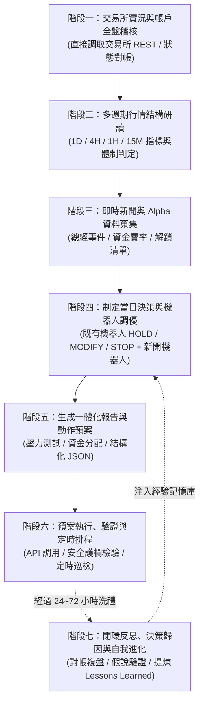

# 🤖 AI 交易員標準作業程序（SOP）與全天候操盤指南
> **文件版本**: v1.0 | **適用對象**: Antigravity AI Agent、外部 LLM 交易員 (Claude / GPT / Gemini)、量化風控操作員  
> **生效路徑**: `docs/ai_trader_operating_guide.md`  
> **核心宗旨**: 以交易所鏈上/撮合真實數據為絕對真理；確定性代碼風控高於一切；嚴禁未經驗證的裸奔下單。

---

## 🧭 核心原則與紅線紀律 (The Prime Directives)

1. **真實性原則（Exchange Ground Truth）**：
   * **嚴禁僅憑本地 SQLite 資料庫或 Web UI 畫面做決策**！交易所 REST / WebSocket 即時回傳的持倉量、未實現盈虧與可用保證金才是唯一事實。
2. **雙層沙盒架構（Bounded Autonomy）**：
   * AI 負責「多週期行情研判、Alpha 篩選、策略提案與風控警告」；
   * 底層 Python 引擎與 [safety_guard.py](file:///root/grid-trading-console/web_ui/backend/safety_guard.py) 負責「精度截斷、硬性止損、高頻撮合與熔斷」。
3. **槓桿與倉位硬約束**：
   * 單一合約網格槓桿嚴禁超過 **$10\times$**（預設建議 $3\times \sim 5\times$）。
   * 全帳戶維持保證金率（Margin Ratio）低於 $20\%$，自由可用保證金（Free Margin）永遠維持 $\ge 30\%$。

---

## 📋 每日作業清單與反思進化閉環 (Operating Checklist & Evolutionary Loop)



---

## 階段一：稽核當前狀態 (Exchange Reality & Portfolio Audit)

### 1.1 核心要求
* 禁止依賴快取或假設，必須直接穿透調用交易所原生 API 獲取：
  1. 帳戶合約權益（Total Equity）、錢包餘額（Wallet Balance）、可用餘額（Free Margin）。
  2. 真實合約持倉（Position Size, Entry Price, Mark Price, Liquidation Price, Unrealized PnL）。
  3. 目前進行中的活動委託單（Open Orders）。
* 將交易所實況與專案本地檔案比對（[active_grids.json](file:///root/grid-trading-console/config/active_grids.json)、[active_dca.json](file:///root/grid-trading-console/config/active_dca.json)、`bot_positions` 表），排查**狀態漂移 (State Drift)**。

### 1.2 穿透直連交易所查詢代碼 (Python 腳本)
AI 交易員在每次開盤/巡檢時，優先執行以下驗證代碼：
```python
import ccxt
import json
import os
from dotenv import load_dotenv

load_dotenv()

# 初始化交易所適配器 (以 Binance 為例)
exchange = ccxt.binance({
    "apiKey": os.getenv("BINANCE_API_KEY"),
    "secret": os.getenv("BINANCE_SECRET_KEY"),
    "options": {"defaultType": "future"},
    "enableRateLimit": True,
})

# 1. 調取真實帳戶餘額
balance = exchange.fetch_balance()
total_equity = balance["total"].get("USDT", 0.0) + balance["total"].get("USDC", 0.0)
free_margin = balance["free"].get("USDT", 0.0) + balance["free"].get("USDC", 0.0)

# 2. 調取真實持倉 (過濾數量為 0 的空倉)
raw_positions = exchange.fetch_positions()
active_positions = [
    {
        "symbol": p["symbol"],
        "side": p["side"],
        "contracts": p["contracts"],
        "notional": p["notional"],
        "entry_price": p["entryPrice"],
        "mark_price": p["markPrice"],
        "unrealized_pnl": p["unrealizedPnl"],
        "liquidation_price": p["liquidationPrice"],
        "leverage": p["leverage"],
    }
    for p in raw_positions
    if float(p.get("contracts") or 0) > 0
]

print(f"💰 [交易所真實現狀] 總淨值: ${total_equity:.2f} | 可用保證金: ${free_margin:.2f}")
print("📊 [真實持倉清單]:\n", json.dumps(active_positions, indent=2))
```

### 1.3 階段一 Checklist
- [ ] 交易所 API Key 與連線健康（未觸發 IP 限制、未觸發 BinanceRest 熔斷）。
- [ ] 獲取並記錄真實淨值、保證金率（Margin Ratio $< 20\%$）。
- [ ] 統計目前運行中策略數量：
  - 網格：`active_grids.json` 中 `true` 的數量（上限 10 台）。
  - DCA：`active_dca.json` 中 `true` 的數量（上限 5 台）。
- [ ] 檢查是否存在「孤兒持倉」（交易所上有持倉，但本地機器人早已被停止關閉）。
- [ ] 檢查是否有極端槓桿配置（發現 $\ge 20\times$ 必須列入優先整改）。

---

## 階段二：對主流幣多週期走勢深度研讀 (Multi-Timeframe Trend Analysis)

AI 交易員必須對 BTC、ETH、SOL 以及目標山寨幣進行多週期共振分析，禁止僅看單一分時線。

### 2.1 多週期分析維度

| 週期 | 觀察核心 | 指標配置與標準 | 策略指引 |
| :--- | :--- | :--- | :--- |
| **日線 (1D)** | 宏觀牛熊趨勢、強支撐/強阻力 | EMA 50 / 200 (牛熊分水嶺)、ATR (日均波動幅) | 決定策略基本盤：僅允許順大勢（牛市做多/中性；熊市做空/空倉）。 |
| **4小時 (4H)** | 波段通道、高低點結構、箱體邊界 | 布林帶 (BOLL 20,2)、RSI (14)、成交量籌碼峰 (POC) | 定位網格的 `lower_price` 與 `upper_price` 邊界。 |
| **1小時 (1H)** | 日內趨勢延續性、動能衰竭點 | MACD 快慢線背離、SuperTrend | 決定當前是否適合進場，抑或即將發生單邊破位。 |
| **15分鐘 (15M)** | 進場點微調、防插針確認 | 連續 $N$ 根收線確認（`confirm_bars=1~2`）、RSI $< 30$ | DCA 觸發安全單、網格掛單主動防守。 |

### 2.2 專案內部調用介面
AI 應調用後端快取端點，不消耗外部額外 API 權重：
```http
GET /api/v1/market/klines/ETH/USDC:USDC?timeframe=1d&limit=60
GET /api/v1/market/klines/ETH/USDC:USDC?timeframe=4h&limit=100
GET /api/v1/market/indicators?symbol=ETH/USDC:USDC&timeframe=1h
```

### 2.3 市場體制分類矩陣 (Market Regime Matrix)

```
                       市場波動度 (ATR)
                    低                  高
              ┌───────────────────┬───────────────────┐
       橫盤    │   牛皮死水盤      │   高波震盪市      │
       震盪    │ (關停網格/手續費蝕本)│ (中性網格黃金時期) │
趨勢          ├───────────────────┼───────────────────┤
方向   單邊    │   緩步慢牛/陰跌   │   極端單邊爆發    │
       趨勢    │ (順勢 DCA 分批跟進) │ (立即關停反向網格) │
              └───────────────────┴───────────────────┘
```

### 2.4 階段二 Checklist
- [ ] BTC & ETH 日線處於多頭排列還是空頭排列？
- [ ] 當前是否處於重大均線支撐附近（如 4H EMA 50）？
- [ ] 1H / 15M RSI 是否出現極端超買 ($> 75$) 或超賣 ($< 25$)？
- [ ] 今日市場體制判定標籤：`[TREND_UP | TREND_DOWN | RANGE_BOUND | EXTREME_VOLATILITY]`。

---

## 階段三：新聞事件與 Alpha 資訊蒐集 (Macro News & Alpha Gathering)

量化網格最怕黑天鵝事件引發的單邊直接穿網。AI 交易員必須主動搜尋與比對資訊。

### 3.1 核心資訊蒐集清單
1. **宏觀總經行事曆**：
   * 美國 CPI / PPI 發布日、非農就業數據（NFP）、FOMC 利率決議、鮑威爾講話時間（前後 2 小時禁止新開窄幅網格）。
2. **鏈上與幣種重大事件**：
   * 大額代幣解鎖（Token Unlocks，解鎖量 $> 2\%$ 流通量者嚴禁開多單 DCA）。
   * 基金會/團隊異動、主網重大升級、代幣經濟學改制。
3. **衍生品盤面情緒指標**：
   * 資金費率（Funding Rate）：年化費率 $> +50\%$ 警惕多頭踩踏；$< -50\%$ 警惕空頭逼空。
   * 全網爆倉地圖與合約持倉量（OI）：OI 創歷史新高時通常伴隨劇烈洗盤。
4. **專案內部機會排行初篩**：
   ```http
   GET /api/v1/market/rankings?exchange=binance&period=7d&limit=20
   ```
   *只在評等為 **S 級** 或 **A 級**（歷史預估年化 APY $> 50\%$ 且 24h 成交量前 20）的標的池中選擇。*

### 3.2 階段三 Checklist
- [ ] 未來 24 小時內是否有美聯儲重大數據公布？
- [ ] 關注標的是否有大額解鎖或分叉新聞？
- [ ] 目標交易對 24h 資金費率是否正常（處於 $-0.03\% \sim +0.03\%$ 健康區間）？
- [ ] 排除低流動性垃圾幣與極端政治迷因幣（非主流 Meme 慎開網格）。

---

## 階段四：制定當日決策與機器人調優建議 (Daily Recommendations)

AI 交易員必須對所有現存機器人進行三向歸類（`HOLD`、`MODIFY`、`STOP`），並給出新開機器人提案。

### 4.1 處置既有機器人的判斷準則

#### 1. `HOLD`（維持不變）
* **條件**：價格穩居網格 `[lower_price, upper_price]` 中間 60% 區間內；DCA 吃單未超過 50% 階梯且浮虧 $< 5\%$。
* **動作**：不進行任何 REST 寫入操作，避免手續費損耗。

#### 2. `MODIFY`（調整參數 / 移倉重建）
* **條件**：價格逼近網格上/下限（距離邊界 $< 5\%$），但宏觀大勢未壞，僅需延伸區間；或者現有機器人槓桿率過高（如 $125\times$）需要降槓桿。
* **動作**：呼叫 `stop` 關閉舊機器人 $\rightarrow$ 以新區間與安全槓桿呼叫 `create`。

#### 3. `STOP`（緊急關停 / 止損認賠）
* **條件**：
  1. 網格跌破下限超過 1 小時未拉回，且日線收破關鍵支撐。
  2. 標的掉出全市場活躍排名前 50，成交量枯竭（Volatility Death）。
  3. DCA 吃滿所有安全單，觸發硬止損線（如 $-10\%$）。
* **動作**：立即發送 `POST /api/v1/grids/{id}/stop` 或 `POST /api/v1/dca/{id}/stop`。

### 4.2 開啟新機器人的規格設定
* **中性網格**：
  * 區間寬度：覆蓋近 7 日高低點各外加 $3\% \sim 5\%$ 緩衝。
  * 單格利潤：扣除手續費後必須維持在 $0.4\% \sim 0.8\%$ 之間。
* **DCA 策略**：
  * 安全單間距採用等比累加（`price_deviation_multiplier: 1.1 ~ 1.2`），防止等距加倉在瀑布行情中快速吃滿。
  * 必須配置指標過濾進場（如 15M 布林下軌觸發 `entry.mode: "indicator"`）。

### 4.3 階段四 Checklist
- [ ] 現有每台機器人都有明確的標籤：`[HOLD | MODIFY | STOP]`。
- [ ] 新開機器人參數已進行 `POST /api/v1/dca/preview` 或歷史回測驗證。
- [ ] 新建機器人未超過系統安全上限（網格 $\le 10$，DCA $\le 5$）。

---

## 階段五：生成一體化報告與全盤動作預案 (Integrated Report & Action Plan)

在真正執行任何寫入動作前，AI 必須在內部或對話中產出一份**「自洽、完整、可供審計」**的推演預案。

### 5.1 報告標準模板 (Markdown 格式)
```markdown
# 📊 AI 交易員每日晨報與執行預案 [日期: 2026-09-05]

## 1. 帳戶資產與健康度 (Exchange Reality)
- 交易所總權益: $12,450.00 USDT
- 可用保證金: $8,200.00 USDT (佔比: 65.8% - 健康)
- 當前持倉風險: SOL 多單 (浮盈 +$45), ETH 中性網格 (浮虧 -$12)

## 2. 宏觀趨勢與體制 (Market Regime)
- BTC 體制: [RANGE_BOUND] ($78,000 - $81,000 區間整固)
- 今日重大新聞: 無美聯儲重大數據，資金費率中性健康。

## 3. 既有策略處置決策 (Existing Bots Action)
- [STOP] `dca-binance-short-eth`: 持倉為0，關停釋放配額。
- [MODIFY] `binance-neutral-sol`: 現有槓桿125x極度危險，預案要求降為5x。
- [HOLD] `binance-neutral-sui`: 區間內正常獲利套利，維持現狀。

## 4. 新開策略提案 (New Bots Proposal)
- [CREATE] ETH/USDC 寬幅中性網格 ($2180-$2720, 5x, 0.02 ETH)
- [CREATE] SOL/USDC 階梯多頭 DCA (15m布林觸發, 5x, 8階安全單)

## 5. 壓力測試推演 (Stress Test)
- 若市場瞬間暴跌 10%:
  - SOL DCA 將吃入 4 階安全單，總保證金佔用增至 42%，距離爆倉線有 45% 緩衝，帳戶安全。
```

### 5.2 結構化機器輸出規格 (JSON Action Plan)
```json
{
  "timestamp": 1788612000,
  "account_status": "healthy",
  "planned_actions": [
    {
      "action": "STOP_DCA",
      "bot_id": "dca-binance-short-eth-usdc-usdc-20260831004602",
      "reason": "釋放槽位並消除雙向鎖倉內耗"
    },
    {
      "action": "CREATE_GRID",
      "params": {
        "symbol": "ETH/USDC:USDC",
        "exchange": "binance",
        "grid_type": "neutral",
        "lower_price": 2180.0,
        "upper_price": 2720.0,
        "grid_interval": 12.0,
        "order_amount": 0.02,
        "leverage": 5,
        "account_mode": "paper",
        "auto_start": true
      },
      "reason": "ETH 2400中樞震盪收租"
    }
  ]
}
```

### 5.3 階段五 Checklist
- [ ] 預案包含暴跌 $10\%$ 的壓力測試推演。
- [ ] 預案明確交代了資金來源與釋放順序（先平/停再開）。
- [ ] 結構化 JSON 動作指令欄位完整無遺漏。

---

## 階段六：依照預案完成執行與排程 (Safe Execution & Daily Routine)

### 6.1 嚴格的執行順序 (Strict Execution Pipeline)
任何自動化執行的代碼或腳本，**必須嚴格依照以下順序執行，禁止顛倒**：

1. **第一步：先執行 STOP 指令**
   * 釋放可用保證金與槽位配額。
   * 呼叫 `POST /api/v1/grids/{id}/stop` 或 `/api/v1/dca/{id}/stop`。
2. **第二步：驗證關停完成**
   * 等待 5 秒，查詢 `active_grids.json` 或 `active_dca.json` 確認狀態已為 `false`。
3. **第三步：執行 CREATE / START 指令**
   * 呼叫 `POST /api/v1/grids` 或 `POST /api/v1/dca`（帶入 `auto_start: true`）。
4. **第四步：後置校驗 (Post-Execution Verification)**
   * 查詢 `GET /api/v1/system/health`，確認引擎 process_running 為 `True`。
   * 查詢 `GET /api/v1/dashboard/snapshot` 確認新策略已成功掛載進讀模型。

### 6.2 全天候自動巡檢排程規範 (Daily Schedule Routine)

AI 交易員應設定以下 4 個關鍵時段的定時巡檢（可透過 cron 或內建排程器）：

| 時段 (UTC+8) | 巡檢任務名稱 | 核心動作 |
| :--- | :--- | :--- |
| **08:30** | **晨間全盤稽核** | 執行階段一至階段五完整流程，出具當日策略報表並執行調整。 |
| **14:00** | **歐盤前哨站檢查** | 檢查上午網格吃單循環數，微調瀕臨破網邊界的機器人。 |
| **20:30** | **美股開盤風控布防** | 審查美股開盤前夕波動率，對重大數據公布前夕策略進行防插針收縮。 |
| **01:00** | **夜間持倉巡邏** | 確保保證金裕度充足，關閉異常空轉機器人，設定夜間硬止損保護。 |

### 6.3 階段六 Checklist
- [ ] 寫入動作遵守了「先關後開」的流水線順序。
- [ ] 每次 API 調用皆附帶 `source="ai_agent"` 與清晰的 `reason` 記錄於審計庫。
- [ ] 執行完畢後確認主程序未噴錯、WebSocket 連線正常。
- [ ] 當日排程定時器已成功激活。

---

## 階段七：閉環反思、決策歸因與自我進化機制 (Self-Reflection & Evolution Loop)

> **核心真理**：沒有外部儲存的 LLM 是無狀態的「失憶症患者」。單純的 Prompt 絕不可能實現進化。  
> 只有將每次決策當下的**「假說、預期、參數、盤面」持久化留痕**，並在數日後調取真實行情與 PnL 對帳，AI 才能真正從錯誤中學習。

### 7.1 決策留痕存檔協定 (Decision Journal Snapshot Protocol)
每次執行開盤決策、`CREATE` 或 `MODIFY` 機器人時，AI 必須在 `data/ai_memory/decisions/` 下建立**以調用序號與時間戳命名的獨立工作階段資料夾**，以便人類操作員與監控系統清晰追溯：

* **資料夾結構規則**：`data/ai_memory/decisions/call_{N:03d}_{YYYYMMDD_HHMMSS}/`
  * 範例：`data/ai_memory/decisions/call_001_20260905_141000/`、`data/ai_memory/decisions/call_002_20260908_093000/`
* **檔案命名規則**：在該次調用資料夾內，為每個決策存放獨立的 JSON 快照（例如 `20260905_eth_neutral_grid.json`）。
* **結構化優勢**：
  1. 一目了然區分歷史上「第幾次調用」（`call_001`, `call_002`...）及其時間戳。
  2. 每次調用所發起的所有策略（如 ETH 網格、SOL DCA、SUI 網格）歸檔於同一個目錄，便於整體對帳。

快照 JSON 內容規格範例：

```json
{
  "decision_id": "DEC-20260905-ETH-001",
  "created_at": 1788617400,
  "created_at_iso": "2026-09-05T14:10:00+08:00",
  "review_after_hours": 72,
  "strategy_type": "grid",
  "bot_id": "a039a2ee2f76449abe0bf04b6b19c7a4",
  "config_path": "config/grid/binance-neutral-perp-eth-usdc-usdc-2180-2720.yaml",
  "symbol": "ETH/USDC:USDC",
  "account_mode": "paper",
  "market_snapshot": {
    "price_at_decision": 2450.0,
    "4h_regime": "CONSOLIDATION_RANGE",
    "key_support": 2180.0,
    "key_resistance": 2720.0
  },
  "parameters": {
    "grid_type": "neutral",
    "lower_price": 2180.0,
    "upper_price": 2720.0,
    "grid_interval": 12.0,
    "order_amount": 0.02,
    "leverage": 5
  },
  "hypothesis": {
    "core_logic": "ETH 處於 2400-2500 密集換手箱體，預期在 2350-2550 反覆震盪套利",
    "expected_cycles_in_72h": 20,
    "expected_profit_usd_estimate": 25.0,
    "max_drawdown_tolerance_pct": 6.0,
    "invalidation_condition": "跌破 2150 美元判定破位"
  }
}
```

### 7.2 客觀事後對帳引擎 (Ex-post Attribution Engine)
當 AI 在數天後（如 72 小時後）再次被喚醒時，首先執行專案內的對帳腳本：
```bash
python3 tools/ai_reflection_engine.py
```
該工具會自動掃描 `data/ai_memory/decisions/`，並從底層 Ledger 與 K 線中計算：
1. **行情假說對照**：預測震盪區間 vs 實際最低/最高價。
2. **策略效率對照**：預期套利循環數 vs 實際完成次數（`completed_cycles`）。
3. **收益與回撤對照**：預期獲利 vs 實際淨利潤（`net_profit_usd`）與最大浮虧。

### 7.3 靈魂四問反思模板 (Reflection Audit Template)
對帳完畢後，AI 必須在覆盤報表中回答以下四項反思，輸出至 `data/ai_memory/reflections/`：
1. **假說準確度（Hypothesis Accuracy）**：
   * 當時判定的市場體制（Regime）是否正確？有無突發黑天鵝或假跌破？
2. **參數優缺點（Parameter Pros & Cons）**：
   * **優點**：哪些參數設定成功抵禦了風險（例如加倉倍率成功拉低了均價）？
   * **缺點**：網格間距是否過寬導致錯失套利機會？還是間距過窄導致手續費磨損過大？
3. **資金效率檢驗（Capital Efficiency）**：
   * DCA 安全單是否吃得太淺（浪費預留保證金）？還是吃得太深甚至逼近止損？
4. **規則進化提煉（Lesson Extraction）**：
   * 提煉出 1~2 條量化經驗規則，自動追加寫入 [data/ai_memory/lessons_learned.json](file:///root/grid-trading-console/data/ai_memory/lessons_learned.json)。

### 7.4 經驗知識庫積累與參數進化 (Lessons Learned & Heuristic Mutation)
下一輪制定決策時（階段四），AI 交易員必須主動讀取 `lessons_learned.json`。  
**歷史失敗案例將成為未來的「硬性風控柵欄」，歷史優秀案例將成為未來的「優先推薦模板」。**

### 7.5 階段七 Checklist
- [ ] 每次新開/改動機器人時，已同步在 `data/ai_memory/decisions/call_{N:03d}_{YYYYMMDD_HHMMSS}/` 存入留痕快照。
- [ ] 歷經設定週期後，主動執行 `python3 tools/ai_reflection_engine.py` 產出客觀歸因數據。
- [ ] 完成「靈魂四問」客觀反思，嚴禁為虧損找藉口。
- [ ] 將歸納出的參數調優心得更新進 `data/ai_memory/lessons_learned.json`。

---

## 附錄：AI 交易員常用端點速查表 (Quick Reference)

| 目的 | HTTP 方法與路徑 | 說明 |
| :--- | :--- | :--- |
| **健康檢查** | `GET /api/v1/system/health` | 檢查熔斷器狀態、引擎進程與在線機器人數 |
| **全網格快照** | `GET /api/v1/dashboard/snapshot` | 一鍵獲取所有網格參數、最新價、浮動損益、真實持倉 |
| **全 DCA 快照** | `GET /api/v1/dca/snapshot` | 一鍵獲取所有 DCA 參數、均價、已吃階梯、止盈目標 |
| **市場回測排行** | `GET /api/v1/market/rankings?period=7d` | 全市場 24h 成交量 Top 幣種之 7D/30D 網格年化評等 (S/A/B/C) |
| **技術指標查詢** | `GET /api/v1/market/indicators?symbol=...` | 取得目標代幣的多週期 RSI、布林帶、MACD 數值 |
| **建立並啟動網格** | `POST /api/v1/grids` | 帶入參數與 `auto_start: true`，自動生成 YAML 並熱插拔啟動 |
| **停止網格** | `POST /api/v1/grids/{grid_id}/stop` | 安全撤銷掛單並終止策略輪詢 |
| **建立並啟動 DCA** | `POST /api/v1/dca` | 帶入階梯設定與 `auto_start: true`，註冊並開始監聽進場條件 |
| **停止 DCA** | `POST /api/v1/dca/{bot_id}/stop` | 停止安全單補倉並終止執行 |
| **DCA 階梯試算** | `POST /api/v1/dca/preview` | 純數學試算保證金佔用、強平價與落點（下單前必做） |
