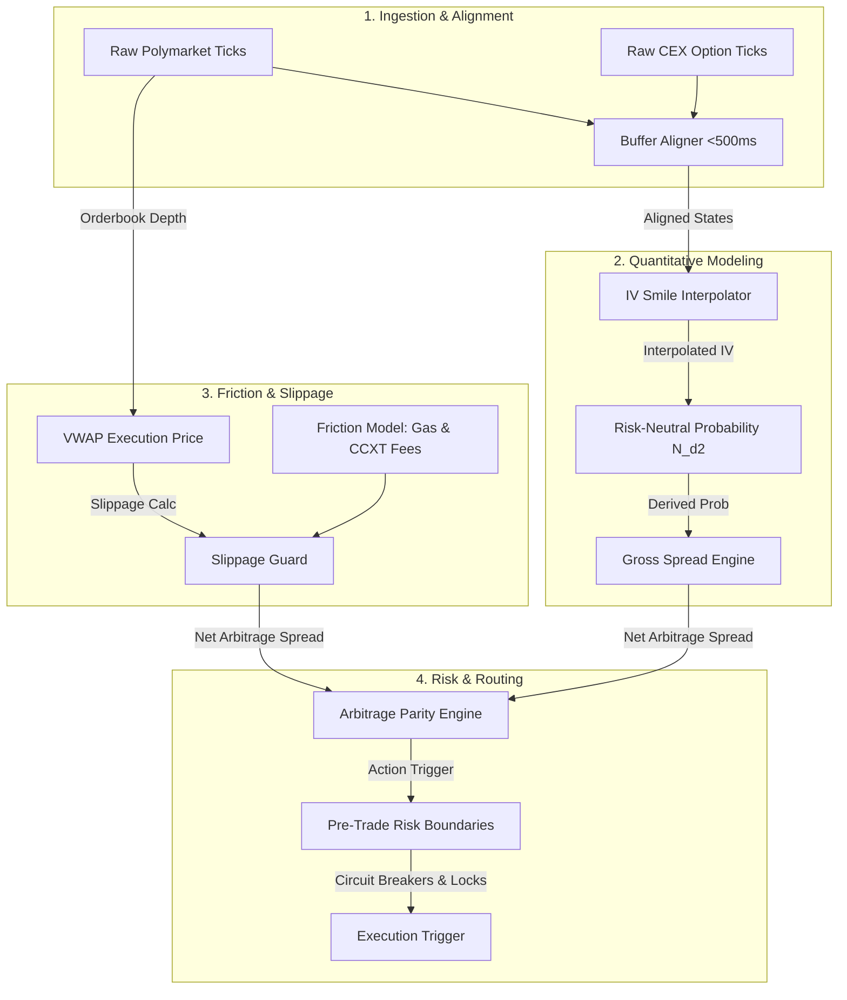

# Arbitrage Engine Verification & Testing Plan
## High-Precision Cross-Market Pricing & Action Triggering Logic

This test plan establishes a rigorous validation suite to verify that the **Crypto Option Bot's backend arbitrage engine** accurately ingests, aligns, standardizes, evaluates, and triggers risk-managed trades. 

---

### 1. Core Testing Objectives

The primary objective is to mathematically and operationally audit the backend pipeline that transforms raw market feeds into high-confidence execution triggers.



Specifically, we must verify:
1. **Mathematical Accuracy**: Implied Volatility (IV) smile interpolation and risk-neutral probability calculations are precise and robust under all market shapes.
2. **Slippage & Depth Realism**: Volume-Weighted Average Price (VWAP) traversal over multi-level orderbooks operates with extreme numerical fidelity.
3. **Frictional Precision**: All exchange fees (CCXT/Deribit maker/taker), Polymarket taker fees, and Polygon gas costs are accounted for in the net spread calculation.
4. **Failsafe Arbitrage Actions**: The system fires the correct trigger (`BUY_YES`, `BUY_NO`, or `WAIT`) based on profitability and risk boundaries.
5. **Execution & Risk Guardrails**: Dual-leg execution locks, transaction cooldowns, risk boundary limits (circuit breakers), and manual/auto routing blocks work correctly.

---

### 2. Mathematical & Functional Rules to Verify

> [!IMPORTANT]
> To prevent execution loss, the test plan maps the mathematical boundaries to strict verification metrics.

#### A. Volatility Smile Interpolation Skew
Traditional Black-Scholes assumes constant volatility. CEX options exhibit a volatility smile (skew). We must verify:
*   **Weighted Quadratic Skew**: Interpolation is smooth, stable, and clamps near boundary extremities to prevent `NaN` or invalid IV shapes.
*   **Cubic Spline Skew**: Smooth derivatives across adjacent strikes, gracefully falling back to linear models if strike density is low ($N < 4$).

#### B. Risk-Neutral Probability Equivalent Odds
Polymarket's binary contract price represents the market's estimate of the probability $P(S_T > K)$. CEX options replication derives the risk-neutral probability:
$$ P_{\text{options}} = e^{-rT} \cdot N(d_2) $$
*   **Time-to-Expiry Defense**: As $T \to 0$, $e^{-rT} \to 1$. We must verify that near-expiry math does not blow up or cause numeric instability.
*   **ATM Probability**: At-the-money (ATM) options with $S = K$ and $r = 0$ must yield a risk-neutral probability of approximately $50\%$.

#### C. Orderbook VWAP Traversal
Rather than checking top-of-book (best bid/ask), the bot evaluates the actual filled VWAP over depth:
$$ \text{VWAP} = \frac{\sum_{i=1}^n \text{Price}_i \times \text{Size}_i}{\text{Total Shares}} $$
*   **Deep Capacity**: If order size fits in level 1, VWAP equals level 1 price.
*   **Slippage Cap**: If traversing down the book results in a price that exceeds the best bid/ask by more than `max_slippage_pct`, the safety check must trigger `WAIT`.

#### D. Net Spread Threshold
$$ \text{Net Spread} = \text{Gross Spread} - \text{Friction Cost per Share} \ge \text{min\_spread\_pct} $$
*   Friction includes CEX taker fee, Polymarket taker fee, and Polygon gas cost.
*   All values must be computed using `decimal.Decimal` to guarantee binary precision safety.

---

### 3. High-Fidelity Test Scenarios & Edge Cases

| Test Case ID | Scenario | Input Conditions | Expected Action | Expected Reason |
| :--- | :--- | :--- | :--- | :--- |
| **TC-01** | Underpriced YES Contract | Polymarket YES Ask: `0.40`<br>Deribit Theoretical: `0.52`<br>Friction: `0.02` per share<br>Min Spread: `1.0%` | **`BUY_YES`** | `arbitrage_opportunity_found`<br>Net Spread: `+10.0%` |
| **TC-02** | Overpriced YES Contract<br>(Underpriced NO) | Polymarket YES Bid: `0.65`<br>Deribit Theoretical: `0.48`<br>Friction: `0.02` per share<br>Min Spread: `1.0%` | **`BUY_NO`** | `arbitrage_opportunity_found`<br>Net Spread: `+15.0%` |
| **TC-03** | Insufficient Net Spread | Polymarket YES Ask: `0.49`<br>Deribit Theoretical: `0.52`<br>Friction: `0.035` per share<br>Min Spread: `1.0%` | **`WAIT`** | `spread_below_minimum` |
| **TC-04** | Thin Depth Slippage Violation | Polymarket YES Ask L1: `0.40` (Size: 10)<br>Polymarket YES Ask L2: `0.50` (Size: 1000)<br>Target: `$100 USD` (VWAP ~ `0.49`) | **`WAIT`** | `slippage_exceeded_limit`<br>(Slippage ~ `22.5%` > `1.5%`) |
| **TC-05** | Extreme Short Expiry ($T \to 0$) | Spot: `70000`, Strike: `70000`<br>Expiry: `30 seconds` ($T \approx 9.5 \times 10^{-7}$)<br>Theoretical Probability: `~50%` | **Stable Run** | Mathematics remain stable. Risk checks execute without numerical division errors. |
| **TC-06** | Mathematical Solver Failure | Strike: `150000` (Extreme OTM)<br>Option bids/asks: `0.00`<br>Empty volatility arrays. | **`WAIT`** | `math_pricing_failed` |
| **TC-07** | Pre-Trade Risk Limit Block | Target Position Size: `$1200 USD`<br>Max Position Limit: `$1000 USD` | **Execution Block** | Rejected by Risk Checker with `position_limit_exceeded` |
| **TC-08** | Post-Trade Drawdown Circuit Breaker | Simulated loss of `$600 USD`<br>Max drawdown threshold: `$500 USD` | **Circuit Breaker Trip** | Auto-close active. Future evaluations block on `circuit_breaker_active` |
| **TC-09** | Cooldown & Mutex Lock Safety | Trigger arbitrage tick at $t_0$<br>Trigger overlapping tick at $t_0 + 100$ms | **Single Execution** | Lock intercepts 2nd trade instantly. Cooldown sets `trade_cooldowns` to prevent duplicated routing. |

---

### 4. Verification Implementation Strategy

To automate these checks, we will create a dedicated test module:
`tests/test_arbitrage_engine.py`

#### Running the Test Suite
The automated validation is run directly in the environment:
```bash
pytest -v tests/test_arbitrage_engine.py
```

> [!TIP]
> **Continuous Verification Integration**
> All tests are integrated with standard `pytest` decorators, allowing them to be run continuously as part of pre-deployment validation.
