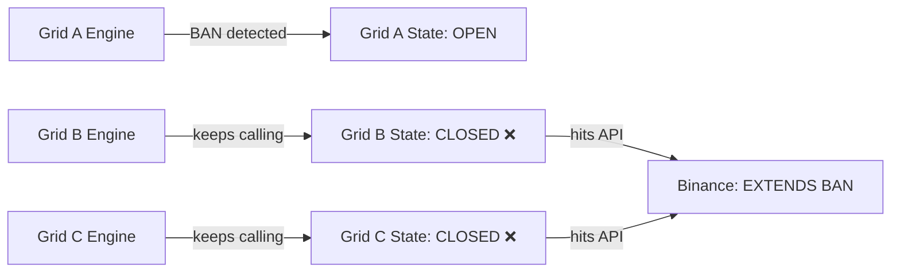
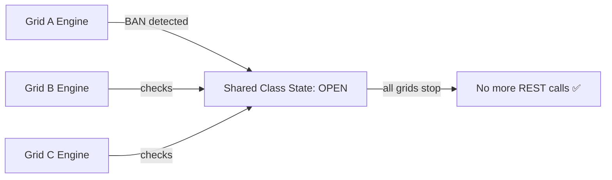

# 🔥 Shared Circuit Breaker Fix — Binance API BAN Escalation

## Problem

When running multiple grid strategies concurrently via `run_multiple_grids.py`, each `GridEngineImpl` instance had its **own isolated** circuit breaker state (`_api_circuit_until`, `_last_api_error_code`). When one grid detected a `-1003` (IP BAN) error:

1. **Grid A** would set its circuit breaker → stop REST calls ✅
2. **Grid B** continued making REST calls → didn't know about the BAN ❌
3. Grid B's calls hit the BAN → Binance extended the ban duration ❌
4. `PositionMonitor` and `BalanceMonitor` of Grid B continued polling → further escalation ❌



## Root Cause

- `_api_circuit_until` and `_last_api_error_code` were **instance variables** (set in `__init__`)
- Each `GridEngineImpl(shared_adapter)` created a separate engine with separate state
- The persisted file (`data/.circuit_breaker_state.json`) was only read at constructor time, not re-checked dynamically

## Solution

Promoted circuit breaker state from **instance variables** to **class-level variables** shared across all `GridEngineImpl` instances:



### Key Design Decisions

1. **Class variables with property bridges** — Added `@property` accessors so all existing `self._api_circuit_until` references resolve to the shared class-level state without code changes
2. **Only-extend-never-shorten** — When a new BAN is detected, only update if the new deadline is *longer* (prevents a shorter BAN from overriding a longer one)
3. **One-time persisted state loading** — The file-based state is loaded only by the first instance via `_shared_circuit_initialized` flag

## Files Modified

### 1. [grid_engine_impl.py](file:///root/nofx_recovered/crypto-trading-open/core/services/grid/implementations/grid_engine_impl.py)

render_diffs(file:///root/nofx_recovered/crypto-trading-open/core/services/grid/implementations/grid_engine_impl.py)

### 2. [run_multiple_grids.py](file:///root/nofx_recovered/crypto-trading-open/run_multiple_grids.py)

render_diffs(file:///root/nofx_recovered/crypto-trading-open/run_multiple_grids.py)

## What Already Worked (No Changes Needed)

| Component | Why It Works |
|---|---|
| `BalanceMonitor` | Already calls `self.engine._is_circuit_open()` → now reads shared class state |
| `PositionMonitor` | Already calls `self.engine._parse_and_set_circuit()` on errors → writes to shared state |
| `GridCoordinator.initialize()` | Already checks `self.engine._is_circuit_open()` before starting |
| Batch order retries | Already checks `self._is_circuit_open()` before each retry round |
| `_active_window_refresh_loop` | Already checks `self._is_circuit_open()` before polling |

## Data Flow After Fix

```
Grid A gets -1003 error
    → engine_a._parse_and_set_circuit(error)
    → writes to GridEngineImpl._shared_api_circuit_until (CLASS level)
    → immediately visible to engine_b, engine_c, ...

Grid B's next loop iteration:
    → engine_b._is_circuit_open() → reads CLASS variable → returns True
    → skips all REST calls ✅

Grid B's PositionMonitor:
    → engine_b._is_circuit_open() → True → skips REST ✅

Grid B's BalanceMonitor:
    → engine_b._is_circuit_open() → True → skips REST ✅

Grid B's stats loop (run_multiple_grids.py):
    → engine_b._is_circuit_open() → True → skips stats query ✅
```

## Testing

All cross-instance sharing verified:
- ✅ Initial state: both engines closed
- ✅ Engine A sets BAN → Engine B sees it immediately
- ✅ Class, A, B all reference same value
- ✅ Longer BAN extends the timeout
- ✅ Shorter BAN does NOT override longer BAN
- ✅ Permanent -2015 circuit affects all instances
