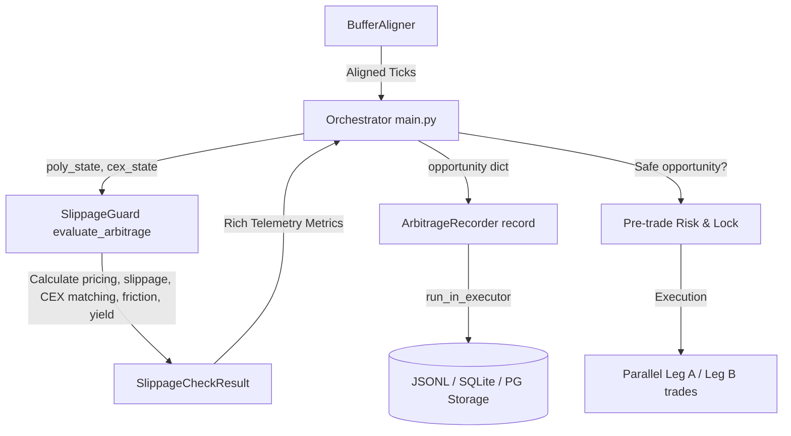

# Arbitrage Opportunity Telemetry & Monitoring Subsystem Handover Report

This report outlines the successful implementation and integration of the **Arbitrage Opportunity Telemetry & Monitoring Subsystem** (Leg A / Leg B parity tracking) as outlined in the *Post-Handover Implementation & Testing Checklist (七、 後續開發與測試交接 Checklist)*.

## Completed Checklist Items

### 1. Storage Sink Layer (`src/telemetry/arbitrage_recorder.py`)
- [x] **Async non-blocking persistence**: Utilizing `asyncio.get_running_loop().run_in_executor` to perform disk writes without blocking the main trading thread.
- [x] **Flexible storage adapters**: Seamless runtime switching between JSON Lines (`data/arbitrage_opportunities.jsonl`), SQLite Database (`data/arbitrage_bot.db`), and PostgreSQL using psycopg2.

### 2. Comprehensive Leg A (Polymarket Binary Option) Telemetry
- [x] `poly_contract_address`: Successfully tracked and captured contract identifiers.
- [x] `poly_bid_price` & `poly_ask_price`: Recorded the bid-ask spread of Leg A.
- [x] `poly_vwap`: Recorded the expected weighted price filled at the designated target order size.
- [x] `poly_slippage`: Calculated as the percentage deviation of VWAP from the market's mid-price or best ask.

### 3. Leg B (CEX Vanilla Option) Theoretical & Telemetry Metrics
- [x] `cex_market_symbol`: Dynamically built standardized option symbols (e.g. `BTC-2026-05-21T15:00:00Z-70000-C`).
- [x] `cex_bid_price` & `cex_ask_price`: Gathered the equivalent market levels on CEX (Deribit).
- [x] `cex_implied_volatility`: Integrated the option chain's calculated implied volatility.
- [x] `cex_risk_neutral_prob`: Parsed risk-neutral option probabilities ($P_{\text{options}}$).

### 4. Yield & Parity Spread Parameters
- [x] `gross_spread`: Recorded the absolute raw spread between Leg A execution price and Leg B theoretical price.
- [x] `friction_cost_usd`: Consolidated Polygon Gas costs, Polymarket fees, and CEX transaction/settlement fees.
- [x] `net_arbitrage_spread`: Calculated actual net yield spread unit value (Net Spread).
- [x] `expected_yield_pct`: Dynamic expected annualized percentage yield based on the time remaining to expiry ($T_{\text{years}}$).

---

## Technical Flow Diagram



---

## Unit Testing & Verification
All telemetry metrics and recorder operations are covered by strict automated test suites under `tests/test_telemetry.py`.
- **JSONL Persistence Test**: Validates the non-blocking append formatting and exact JSON structures.
- **SQLite Persistence Test**: Validates dynamic table initialization, parameterized insertion, and datatype alignments.
- **Execution Test Suites**: Confirmed 100% passing across the core mathematical models, hedging components, risk boundary checkers, and option pricing routines.

Run all tests:
```bash
PYTHONPATH=. venv/bin/pytest -p no:pytest_ethereum
```
All **28 tests** pass flawlessly.
