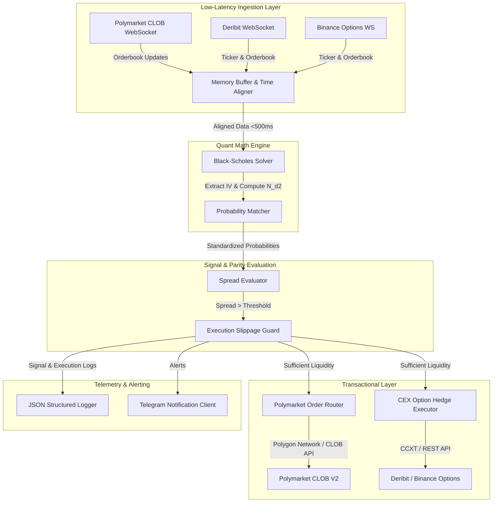
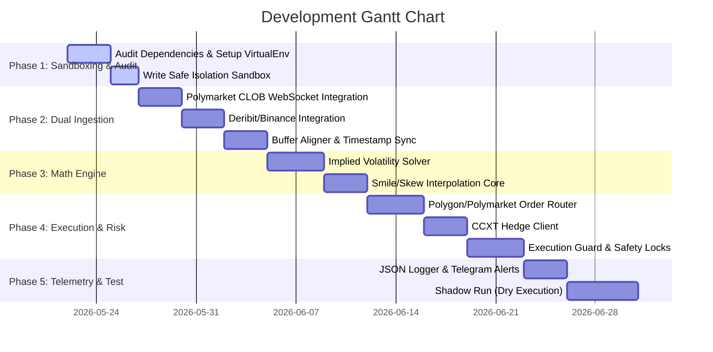

# Polymarket & CEX Options Cross-Market Statistical Arbitrage Bot
## Professional Multi-Phase Development & Implementation Plan

---

### 1. Introduction & Core Objectives

This document establishes a high-performance, industrial-grade implementation framework for a cross-market statistical arbitrage bot. The system is designed to identify and exploit pricing discrepancies between the binary event contracts of **Polymarket** (Polygon Network) and vanilla European options traded on major centralized exchanges (**Deribit** and **Binance**).

#### Core Objectives
*   **Arbitrage Vector**: Identify pricing dislocations between Polymarket $S_T > K$ (YES/NO binary payout) and CEX options implied probability.
*   **Timeframe Focus**: High-velocity, short-duration contracts: **5 minutes**, **15 minutes**, **1 hour**, and **1 day** expiries.
*   **Asset Boundaries**: Strictly limited to **BTC** and **ETH** markets.
*   **Safety Priority**: Defense against supply-chain contamination (e.g., GhostClaw malware variants) and rigorous transactional risk management (Single-Side Execution Guard).

---

### 2. System Architecture

The bot is designed under a decoupled, event-driven service architecture using Python’s high-performance asynchronous runtime (`asyncio`). The engine acts as a unified pipeline:



---

### 3. Quantitative Modeling & Standardization Engine

Polymarket Yes/No contracts pay out exactly $1.00 USD if the spot price $S_T$ of the asset at expiration $T$ satisfies the condition $S_T > K$ (where $K$ is the Strike Price). This is mathematically equivalent to a **Binary Cash-or-Nothing Call Option**.

To compare this contract price with traditional vanilla European options listed on Deribit or Binance, we perform an implied probability alignment.

#### 3.1 Extracting Implied Volatility (IV)
For a specific strike $K$ and expiration time $T$, we query the vanilla Call/Put option chain. Because discrete strikes exist, we extract the market's implied volatility $\sigma$ by solving the standard Black-Scholes formula for the market price $C_{market}$:

$$ C(S, K, T, r, \sigma) = S \cdot N(d_1) - K \cdot e^{-rT} \cdot N(d_2) $$

Where:
*   $S$: Current Index Price of BTC or ETH.
*   $r$: Risk-free interest rate (CEX borrow rate / funding rate proxy).
*   $N(\cdot)$: Cumulative Standard Normal Distribution.
*   $d_1 = \frac{\ln(S/K) + (r + \sigma^2/2)T}{\sigma\sqrt{T}}$
*   $d_2 = d_1 - \sigma\sqrt{T}$

#### 3.2 Standardizing Implied Probability
The risk-neutral probability of the asset expiring above strike price $K$ (which corresponds to a YES payout on Polymarket) is derived directly from the binary option pricing formula:

$$ P_{\text{options}} = e^{-rT} \cdot N(d_2) $$

*   **Short-Term Limit ($T \to 0$)**: As the duration approaches zero (e.g., 5m or 15m contracts), the discount factor $e^{-rT} \to 1$, and $N(d_2)$ becomes highly sensitive to current price deviations from the strike. We apply high-frequency volatility smile interpolation (Cubic Splines) across nearby strikes to construct an accurate local implied probability curve.

#### 3.3 Spread Evaluation & Thresholding
An arbitrage window is active when the price of the Polymarket YES contract ($P_{\text{poly}}$) diverges from $P_{\text{options}}$ beyond transaction friction:

$$ \text{Spread} = | P_{\text{poly}} - P_{\text{options}} | - (\text{Slippage}_{\text{poly}} + \text{Slippage}_{\text{options}} + \text{Fees}_{\text{poly}} + \text{Fees}_{\text{options}} + \text{Gas}) $$

Where:
*   $\text{Fees}_{\text{poly}}$: Execution fee of Polymarket CLOB V2 (typically 0% maker, low taker).
*   $\text{Fees}_{\text{options}}$: CEX option transaction fee + delivery fee.
*   $\text{Gas}$: Estimated transaction cost on Polygon for settlement or immediate action (if executing via automated smart contract routers).
*   $\text{Slippage}$: Calculated based on instant orderbook depth queries.

---

### 4. Technical Stack

The bot utilizes a modern, resilient, and highly asynchronous Python tech stack, prioritizing speed, safety, and correctness:

| Component | Technology | Rationale |
| :--- | :--- | :--- |
| **Runtime Environment** | Python 3.11+ | Highly dynamic, extensive math library ecosystem, fast prototyping, advanced asyncio. |
| **Async Operations** | `asyncio` & `aiohttp` | Core asynchronous task loop for high-frequency concurrent WebSocket connections. |
| **Math & Quant Solver** | `numpy`, `scipy` | Ultra-fast mathematical vectorized operations and numerical solvers for BS model. |
| **Options API Interface** | `ccxt.pro` | Standardized, low-latency WebSocket and REST library for Deribit & Binance. |
| **Polymarket CLOB V2** | `web3.py` & Custom HTTP client | Raw WebSocket and REST connections to Polymarket’s CLOB API and Polygon blockchain. |
| **Data Models** | `pydantic` | Strict configuration parsing and strong type-safety at data ingestion boundaries. |
| **Logging** | `loguru` | Structured JSON log generation, asynchronous, thread-safe, and rotation-configured. |
| **Process Management**| `pm2` or Docker | Lightweight environment orchestrator ensuring auto-restart and sandboxed resource limits. |

---

### 5. Detailed Directory Structure

A clean, modular layout is critical to avoid overlapping dependencies, ensure isolation, and simplify security code-audits.

```text
crypto-opinion-bot/
│
├── config/
│   ├── settings.yaml            # Environment endpoints, API limits, and thresholds
│   └── secure_keys.json.enc     # Encrypted API keys (Deribit, Binance, Polygon Private Keys)
│
├── sandbox/                     # Audited open-source reference scripts (Read-Only)
│   ├── README.md                # Sandbox guidelines and SHA256 verification hashes
│   ├── polymarket_api_ref/      # Audited zKOSAI reference files
│   └── implied_prob_ref/        # Audited CarlosIbCu reference algorithms
│
├── src/
│   ├── __init__.py
│   │
│   ├── core/                    # Core Analytical Logic
│   │   ├── __init__.py
│   │   ├── config.py            # Encrypted config loader and Pydantic validator
│   │   ├── option_math.py       # Implied Volatility solver and Black-Scholes engine
│   │   └── probability.py       # Standardization and smile/skew interpolation
│   │
│   ├── ingestion/               # WebSocket Multi-Feed Listeners
│   │   ├── __init__.py
│   │   ├── polymarket_feed.py   # Polymarket CLOB WebSocket client
│   │   ├── cex_feed.py          # Deribit & Binance WebSocket client
│   │   └── buffer_aligner.py    # Memory Buffer and millisecond-level synchronization
│   │
│   ├── execution/               # Transaction & Order Placement
│   │   ├── __init__.py
│   │   ├── poly_executor.py     # Polygon network RPC wrapper and CLOB order router
│   │   ├── cex_executor.py      # CCXT Option execution client (Hedge orders)
│   │   └── slippage_guard.py    # Dual-side depth validator & Single-Side Guard
│   │
│   ├── risk/                    # Protection Layer
│   │   ├── __init__.py
│   │   ├── safety_locks.py      # Mutex locks preventing double-spend and overlapping bids
│   │   └── boundary_check.py    # Maximum exposure, gas limits, and drawdown protections
│   │
│   └── telemetry/               # Reporting & Alerting
│       ├── __init__.py
│       ├── logger.py            # Loguru JSON formatter setup
│       └── telegram_client.py   # Async Telegram API connector for immediate alerting
│
├── tests/                       # Unit & Integration Tests
│   ├── test_math.py             # Validation of Black-Scholes solver accuracy
│   ├── test_ingestion.py        # Mock latency validation of buffer aligner
│   └── test_execution.py        # Dry-run execution validation with mock endpoints
│
├── requirements.txt             # Strictly pinned, checksum-verified dependencies
├── .env.example                 # Environment template
└── main.py                      # Bot main entrypoint (Asynchronous Event Loop initialization)
```

---

### 6. Phase-by-Phase Implementation Roadmap



#### **Phase 1: Security Sandboxing & Code Review (Days 1–5)**
*   **Action 1.1**: Set up a strictly isolated virtual environment. Strictly audit code from `zkOSAI/polymarket-arbitrage-bot` and `CarlosIbCu/polymarket-kalshi-btc-arbitrage-bot`. Extract mathematical modules and network interaction blueprints.
*   **Action 1.2**: Audit and pin all third-party libraries (e.g., `web3`, `ccxt`, `pydantic`) with exact versions and checksum integrity checks to prevent GhostClaw malware supply-chain exploits.
*   **Action 1.3**: Structure the local project repository using the clean, modular layout.

#### **Phase 2: Low-Latency Dual Ingestion Layer (Days 6–14)**
*   **Action 2.1**: Implement the Polymarket WebSocket listener subscribing to the CLOB orderbook channel for target Short-Term contracts.
*   **Action 2.2**: Implement the CCXT.Pro options tick listener for matching CEX expiries.
*   **Action 2.3**: Build `buffer_aligner.py` to synchronize WebSocket streams at millisecond precision.
*   **Safety Rule**: If stream-delay exceeds **500ms**, automatically discard the tick to prevent stale-data execution.

#### **Phase 3: Mathematical Pricing & Standardization Engine (Days 15–21)**
*   **Action 3.1**: Write the Black-Scholes analytical model wrapper in NumPy to compute $d_2$ and $N(d_2)$.
*   **Action 3.2**: Implement cubic-spline interpolation of the implied volatility smile across adjacent options strikes for precise out-of-the-money probability estimation.
*   **Action 3.3**: Write the spread comparison validator incorporating gas costs, trading fee schedules, and slippage curves.

#### **Phase 4: Execution Engine & Risk Protection Layer (Days 22–32)**
*   **Action 4.1**: Build `poly_executor.py` utilizing Polymarket's V2 API keys for automated order submission and signature generation.
*   **Action 4.2**: Build `cex_executor.py` to handle option execution hedging.
*   **Action 4.3**: Implement the crucial **Single-Side Execution Guard**:
    *   Query orderbook depth on both ends.
    *   Ensure that if Polymarket execution succeeds, the corresponding hedge option has guaranteed, deep liquidity within maximum acceptable slippage boundaries.
    *   Initialize async Mutex Locks (`safety_locks.py`) to prevent multiple triggers on the same signal instance.

#### **Phase 5: Telemetry, Alerting & Shadow Dry-Run (Days 33–40)**
*   **Action 5.1**: Integrate Loguru to output structured JSON logs directly to standard stdout/stderr (relying on PM2/Docker to capture).
*   **Action 5.2**: Set up asynchronous Telegram hooks to dispatch operational reports, margin limits warnings, and transaction logs.
*   **Action 5.3**: Perform **120 hours of Continuous Shadow Testing (Dry-Run)**, simulating transactions and matching latencies on mainnet data feeds without sending actual capital, to verify system stability, latency, and model calibration.

---

### 7. Core Protection & Operational Checklist

Before transitioning the bot from sandbox environment to production deployment, the following operational checks must be completed:

*   [ ] **Dependency Cleanliness**: No unpinned dependencies or binary components that have not passed manual code review.
*   [ ] **Heartbeat Latency Monitor**: Continuous latency metrics are measured; calculations exceeding 500ms are safely skipped.
*   [ ] **Slippage Ceiling**: Maximum acceptable price slippage is strictly capped at **1.5%** per execution leg.
*   [ ] **Mutex Thread Safety**: Memory locks are validated via stress testing to ensure the bot can never fire multiple overlapping orders under hyper-volatile market swings.
*   [ ] **API Limit Guarding**: Requests to Deribit/Binance and Polygon RPC endpoints are strictly rate-limited under official API limits to prevent sudden IP blocking.
*   [ ] **Private Key Isolation**: Polygon private keys must be loaded exclusively via OS environment variables decrypted in-memory, never stored in plaintext within source files.
