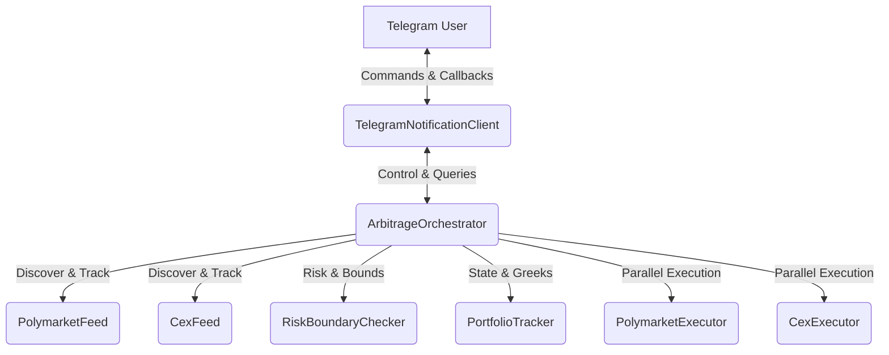

# Phase II Implementation Plan: Live API Integration & Interactive Telegram Bot

This document outlines the detailed plan to implement Phase II (Live API Integration & Interactive Telegram Bot) for the Cross-Market Binary Option and Vanilla Option Statistical Arbitrage Bot.

## 1. Objectives & Goals
* **M1: Live Data WebSocket Ingestion**: Support real-time streaming of Polymarket CLOB orderbooks and Deribit options/spot feeds with low latency.
* **M2: Live Wallet & API Order Placement**: Integrate Polygon EIP-712 offline signing, Polygon gas fee estimation, and Deribit trading API via CCXT Pro to support actual execution.
* **M3: Interactive Telegram Bot**: Create a bi-directional bot that supports operational commands (`/status`, `/portfolio`, `/opportunities`, `/set_spread`, `/set_size`, `/panic_shutdown`) and interactive YES/NO confirmation buttons for manual/interactive mode.
* **M4: Sandbox Verification & Testing**: Verify all functions in Deribit Testnet and Polymarket Sandbox to ensure absolute correctness and reliability.

## 2. Technical Architecture & Component Design

### A. Telegram Notification Client (Interactive Upgrade)
* **Polling Mechanism**: Uses non-blocking async task to poll Telegram's `getUpdates` API.
* **Security Guard**: Only updates originating from the configured `TELEGRAM_CHAT_ID` will be processed.
* **Command Map**:
  - `/status`: Displays connection statuses, active/manual mode, current heartbeat skew, risk limits.
  - `/portfolio`: Lists active arbitrage positions, net Delta/Gamma, cumulative PnL, NAV.
  - `/opportunities`: Shows the top 3 live arbitrage opportunities currently aligned in buffer.
  - `/set_spread <value>`: Dynamically overrides `min_spread_pct` in settings.
  - `/set_size <value>`: Dynamically overrides `max_position_size_usd` in settings.
  - `/set_mode <auto|manual>`: Switches between automatic trading and manual confirmation.
  - `/panic_shutdown`: Emergency shutdown, halts scanning, cancels orders, closes open positions.
* **Inline Callback Queries**: Support `confirm_<opt_id>` and `ignore_<opt_id>` for manual trade approvals.

### B. Live Polymarket & CEX Ingestion (M1)
* Upgrade `polymarket_feed.py` and `cex_feed.py` from dry-run simulations to utilize active WebSocket streams.
* Configure `BufferAligner` with event-driven notifications to ensure that when a newly aligned tick is pushed, it immediately processes it without waiting for polling loops.

### C. Live Execution (M2)
* Support full EIP-712 signing in `PolymarketExecutor` using the private key configured in the decrypted settings.
* Integrate CCXT Pro `deribit` client for real-time WebSocket order placement, order updates, and active account info.

---

## 3. Implementation Steps & Tasks

### Step 1: Upgrade `TelegramNotificationClient`
Implement interactive message receiving, command parsing, inline buttons, security checks, and callback handlers in `src/telemetry/telegram_client.py`.

### Step 2: Implement Real Polymarket EIP-712 Signing and CLOB API Order Placement
Improve `src/execution/poly_executor.py` to correctly interface with Polygon and EIP-712 CLOB V2 specs.

### Step 3: Implement Real CEX CCXT Pro WebSocket Execution
Update `src/execution/cex_executor.py` to support real order placement with API keys and CCXT Pro async calls.

### Step 4: Upgrade `ArbitrageOrchestrator`
Integrate Telegram interactive bot task, manage dynamic settings updates, auto vs manual mode, and implement `/panic_shutdown` logic.

### Step 5: Unit & Integration Testing
Write new regression tests in `tests/` verifying bot command handling, dynamic limits adjustments, EIP-712 signing, and panic shutdowns.
